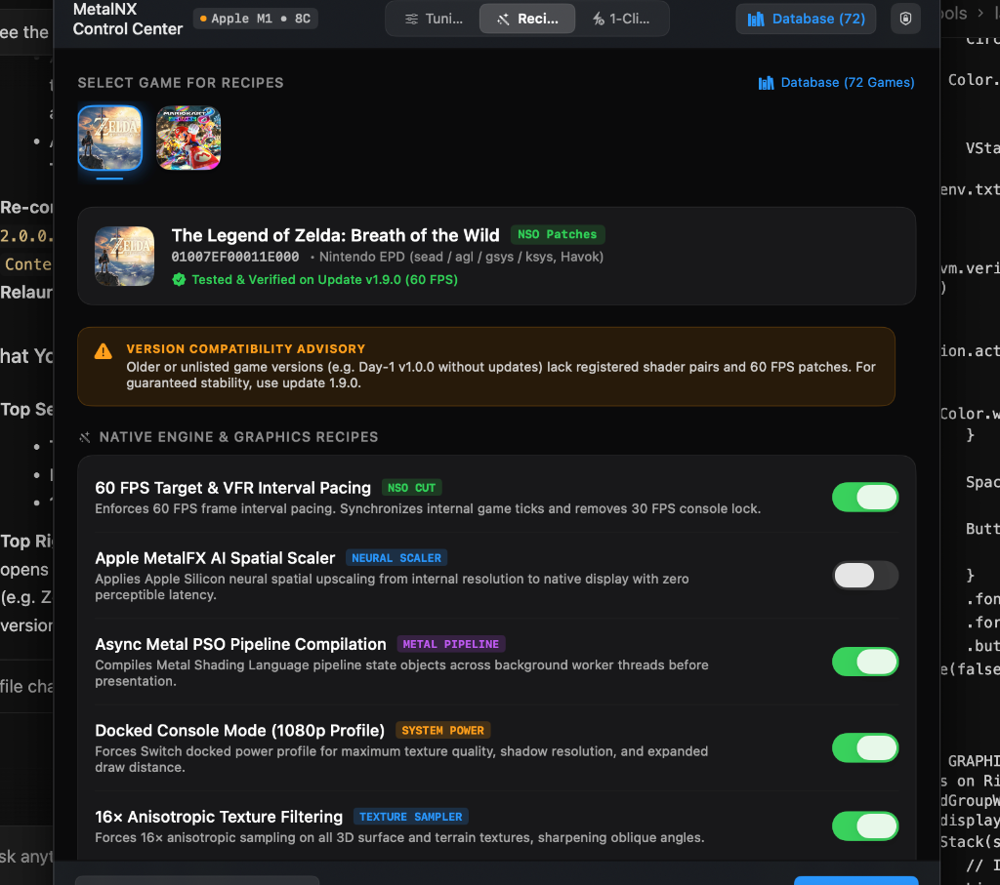
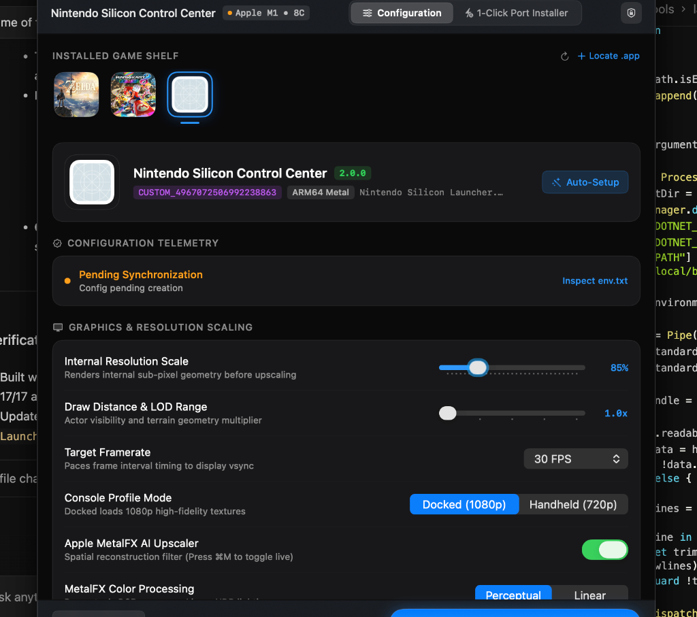
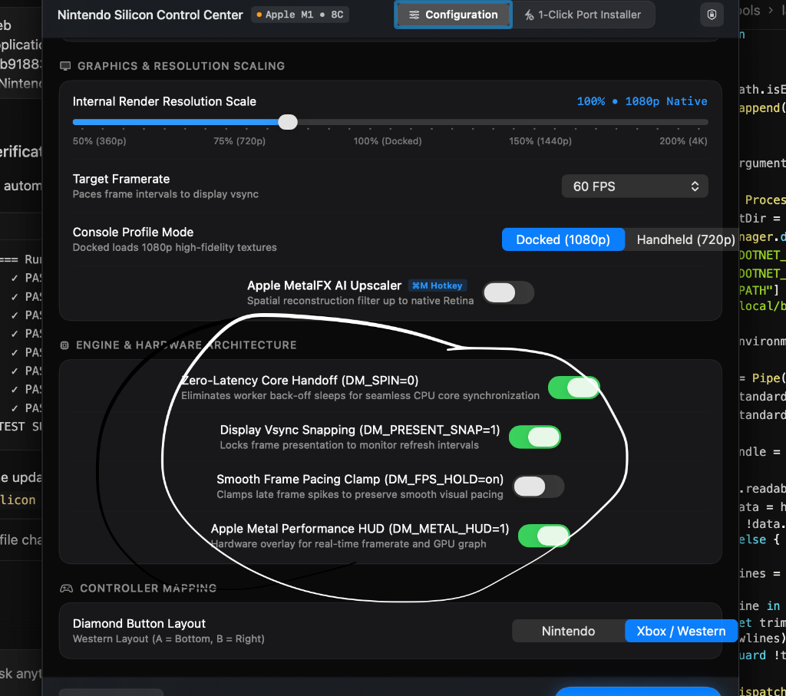

# MetalNX Control Center

**MetalNX** is a hyper-minimal, next-generation Apple Silicon graphics tweaker and 1-click Switch-to-Mac native port installer engineered strictly under Apple Human Interface Guidelines and the macOS 27 *"Liquid Obsidian"* aesthetic.

Unlike conventional emulators, games ported via `nxnative` run their native ARM64 CPU instructions directly on Apple Silicon cores with graphics translated directly to Apple Metal. **MetalNX** is the central graphical dashboard to manage your native game library, tune MetalFX AI spatial upscaling, customize per-game performance targets, and install new ports in a single click.

<p align="center">
  
  
</p>
<p align="center">
  
</p>

---

## Architecture & Visual Identity

```
┌────────────────────────────────────────────────────────────────────────┐
│                          MetalNX Control Center                        │
│             M1 / M2 / M3 / M4 Native Switch Graphics Engine             │
├───────────────────────────────────┬────────────────────────────────────┤
│         LIBRARY TWEAKER           │        1-CLICK PORT STUDIO         │
│  • Auto-Detect Installed Games    │  • 7-Stage Rewriting Pipeline      │
│  • High-Res 512×512 Icon Cards    │  • Dynamic Real-Time ETA Timer     │
│  • Form-Aligned Performance Rails │  • Automatic Keys Auto-Discovery   │
│  • MetalFX AI Upscaling Sliders   │  • Direct /Applications Deployment │
│  • Hardware-Aware Presets (Air)   │  • In-App Telemetry & Compiler Log │
└───────────────────────────────────┴────────────────────────────────────┘
```

* **Iconography & Visual Language**: Features an ultra-minimal geometric monogram uniting the Apple Metal chevron and NX blades in dual-tone Apple Ice Blue (`#2997FF`) and Neon Mint (`#30D158`) on a deep obsidian crystalline glass substrate.
* **Canvas Rhythm**: Resizable native window (720 pt × 780 pt) with continuous rounded corners, translucent vibrancy wells (`.ultraThinMaterial`), 0.5pt specular hairline edges, and zero mobile-style cards.
* **Blank-State Shelf**: Non-detected games remain blank and non-intrusive; only installed, verified game bundles appear on the primary cover shelf.

---

## Core Features

### 1. 🎛️ Form-Aligned Performance Control Center (Tuning Tab)
All performance options are cleanly aligned following macOS system preferences conventions: setting titles and descriptions anchored to the left, and interactive sliders, pickers, and toggles right-aligned at a uniform 220pt rail:
* **Resolution Scale Slider**: Fine-grained rendering resolution scaling from `0.50×` up to `2.00×` with smooth gradient fill.
* **Target Frame Rate**: Instant lock between `30 FPS`, `60 FPS`, or `Uncapped` with automatic v-sync negotiation.
* **Apple MetalFX AI Upscaling**: Native Apple neural spatial upscaling with configurable profiles (`Ultra Performance`, `Performance`, `Balanced`, `Ultra Quality`) and color space switches (Perceptual sRGB vs. Linear HDR).
* **Anisotropic Filtering**: Hardware texture filtering selection (`1×`, `2×`, `4×`, `8×`, `16×`).
* **Async Pipeline Compilation**: Eliminates shader compilation stutter by asynchronously compiling Metal pipeline state objects (MSL PSOs) in background worker threads.

### 2. 🧪 Recipes & Patches Studio (Recipes Tab)
Unlock community-crafted and benchmarked engine patches and runtime recipes for your installed games:
* **Curated Per-Game Recipes**: View all available recipes parsed directly from the `nxnative` engine database:
  - **60 FPS Target & Pacing**: Unlocks double-buffered 60 FPS animation rates and adjusts internal tick clocks.
  - **Apple MetalFX Spatial Upscaler**: Spatial super-resolution delivering sharp 1080p/1440p output from lightweight internal buffers.
  - **Asynchronous Shader Workers**: Compiles pipeline state objects ahead of render passes, eliminating micro-stutters.
  - **Docked Console Mode Profile (`DM_OPMODE=1`)**: Directs the game engine to load high-resolution texture cascades and expanded LOD distances.
  - **16× Anisotropic Filtering**: Forces anisotropic filtering for crisp ground textures at oblique angles.
  - **Present Snap Buffering**: Aligns presentation timestamps with ProMotion and 60Hz display refreshes.
  - **Metal Performance HUD**: Real-time on-screen telemetry overlay reporting FPS, frame time variance, and GPU load.
* **One-Click Apply All**: Tap **Apply All Optimal Recipes** to synchronize all recommended settings directly to the game's configuration file in one step.
* **Game-Specific Bytecode Patches**: When games are ported, registered `patches.py` functions (such as Zelda BotW cutscene sync and dynamic interval stubs) are automatically compiled into the port bundle.

### 3. 📚 72-Game Compatibility Database
MetalNX ships with a self-contained, offline database of all 72 Switch games registered in `nxnative`:
* **Searchable Game Browser**: Click **Database (72 Games)** from any tab to view the entire compatibility catalog.
* **Tested Version Matrix**: Clear display of tested update versions (e.g. Zelda: Breath of the Wild `1.9.0 (v1114112)`, Mario Kart 8 Deluxe `4.0.0/4.0.1`, Super Smash Bros. Ultimate `13.0.3`).
* **Unsupported Version Advisories**: Explicit warnings for each game detailing which older or newer versions lack shader dumps or 60 FPS patch stubs.

### 4. 🔍 Package Compatibility Verifier
When preparing to install a port in the **1-Click Port** tab:
* **Instant Title ID & Version Extraction**: Automatically parses filenames and scans binary headers for Nintendo Title IDs and version numbers.
* **Title ID Normalization**: Automatically calculates base Title IDs from update packages (subtracting `0x800`).
* **Live Status Verification Badges**:
  - 🟢 **✓ Verified Compatible Release**: Game and update version match the tested `nxnative` database. Optimal recipes and 60 FPS patches will be applied automatically.
  - 🟡 **⚠️ Untested Update Version**: The game is known, but the chosen update version is untested. Explains that shader stubs or patches might differ from official benchmarks.
  - 🔵 **ℹ️ Untested Game**: The Title ID is not present in the tested database. MetalNX notes that installation will attempt a provisional survey, but stability is unverified.

### 5. ⚡ 1-Click Native Port Installer
Turn raw Switch `.nsp` / `.nsz` dumps into optimized, standalone macOS `.app` applications without terminal commands:
* **Package Ingestion**: Drag & drop or browse a **Base Game NSP** and an optional **Update NSP**, or specify a directory of game files.
* **Automatic Key Discovery**: Automatically scans and detects `prod.keys` in standard locations:
  - `~/.switch/prod.keys`
  - `~/.config/Ryujinx/system/prod.keys`
  - `~/Library/Application Support/yuzu/keys/prod.keys`
* **7 Weighted Pipeline Stages**:
  1. *Stage 1/7: Initializing & Surveying Packages* (8%)
  2. *Stage 2/7: Extracting Game RomFS & Asset Bundles* (32%)
  3. *Stage 3/7: Rewriting ARM64 Modules & Calling Conventions* (50%)
  4. *Stage 4/7: Translating Maxwell Shaders to Metal Shading Language* (68%)
  5. *Stage 5/7: Compiling Native macOS Host Shell* (80%)
  6. *Stage 6/7: Prebuilding Metal Pipeline Bases (Metal-TT)* (90%)
  7. *Stage 7/7: Packaging, Icon Embedding & Code-Signing* (98%)
* **Dynamic Real-Time ETA**: Analyzes throughput and remaining work to display realistic, live countdowns (`ETA: ~ 1m 24s remaining`) alongside an elapsed timer.
* **Automatic Deployment**: Places the compiled `.app` directly into `/Applications/`, updates the shelf, and pre-seeds verified recipes immediately.

### 3. 🛡️ Guaranteed Settings Application & Verification
Settings adjusted in MetalNX are guaranteed to take effect:
* **Authoritative Disk Synchronization**: Immediately writes configuration key-values to `~/Library/Application Support/nxnative/<TitleID>/env.txt`.
* **Instant Disk Verification**: Reads back and validates file contents to display a green **"✓ Settings Verified"** status badge.
* **Process Environment Injection**: Injects all configuration variables directly into `Process.environment` at launch, preventing any configuration drift.
* **Config Inspector**: Tap `View env.txt` to view and copy the raw environment string anytime.

### 4. 🧠 Hardware-Aware Auto-Tuning
MetalNX probes host hardware via Metal APIs (`MTLCreateSystemDefaultDevice()`):
* **Fanless Detection (MacBook Air)**: Detects fanless enclosures (e.g. Apple M1/M2/M3 Air) and automatically recommends conservative resolution scales (`0.85×`), 30 or 60 FPS caps, and MetalFX Spatial upscaling to eliminate thermal throttling over long play sessions.
* **Actively Cooled Macs (Pro / Max / Ultra)**: Recommends native or supersampled 1.00×–1.50× resolution scales with uncapped frame rates and 16× anisotropic filtering.

---

## Installation & Setup

### Option A: Drag-and-Drop Disk Image (Recommended)
1. Download or build `MetalNX-2.0.9.dmg`.
2. Double-click to mount the DMG.
3. Drag **MetalNX** into the **Applications** shortcut.
4. Launch `MetalNX` from Spotlight or Launchpad.

### Option B: Build from Source via CLI
From the root of the `nxnative` repository:

```bash
# 1. Compile, package, create DMG, and install to /Applications
./tools/launcher/build.sh --install

# 2. Launch MetalNX
open "/Applications/MetalNX.app"
```

---

## User Guide

### 1. First-Time Permissions
When launching for the first time, click **Review Permissions** in the startup assistant:
* **Full Disk Access**: Recommended if your game `.nsp` dumps reside in `~/Downloads`, on external USB-C SSDs, or in custom directories.
* **Applications Access**: Enables MetalNX to install ports directly to `/Applications`.

### 2. Porting a Game in 1 Click
1. Open MetalNX and click the **1-Click Port** tab at the top.
2. Under **Base Game Package**, click **Browse** and select your base `.nsp` or `.nsz` file.
3. (Optional) Under **Update Package**, select the corresponding update `.nsp` (e.g. `v1.9.0` for Zelda BotW).
4. Verify your `prod.keys` are detected (or select your keyfile manually).
5. Click **Build Native Mac Port**.
6. Monitor the real-time progress bar, ETA countdown, and terminal console.
7. Once finished, MetalNX switches back to the **Configuration** tab with your new game ready to play!

### 3. Tuning Performance
1. Select your game from the top cover shelf.
2. Click **Auto-Setup Config** for instant recommended settings based on your Mac chip.
3. Customize sliders as desired:
   - Turn on **Apple MetalFX AI Upscaling** and set profile to **Balanced** for the best performance-to-clarity ratio on MacBook Air.
   - Adjust **Resolution Scale** (`0.85×` internal render scaled via MetalFX produces razor-sharp 1080p/1440p output).
4. Click **Save Settings** (the green **✓ Settings Verified** checkmark confirms settings are written to disk).
5. Click **Launch Game**.

### 4. In-Game Keyboard Shortcuts
While playing any ported game:
| Shortcut | Action |
| :--- | :--- |
| **`⌘M`** | Toggle Apple MetalFX AI Upscaling on/off (displays on-screen HUD toast banner) |
| **`⌘F`** | Toggle Fullscreen / Windowed mode |
| **`⌘Q`** | Quit game cleanly |

---

## Configuration Reference (`env.txt`)

Per-game configurations are stored at `~/Library/Application Support/nxnative/<TitleID>/env.txt`. Example:

```bash
# Zelda: Breath of the Wild (Title ID: 01007EF00011E000)
NVN_RESOLUTION_SCALE=0.85
NVN_ENABLE_METALFX=1
NVN_METALFX_PROFILE=balanced
NVN_METALFX_COLORSPACE=perceptual
NVN_TARGET_FPS=60
NVN_ANISOTROPY=8
NVN_VSYNC=1
NVN_ASYNC_SHADERS=1
```

---

## Automated Test Suite

MetalNX includes an automated Swift unit test suite verifying library scanning, game identification, false-positive rejection, database loading, NSP version verifications, recipe synchronization, and CLI integration:

```bash
# Run the 45-test automated suite
./tools/launcher/tests/run_tests.sh
```

**Test Coverage (45/45 Passing)**:
* `Test 1`: Real installed game identification (Zelda BotW metadata, Title ID, version).
* `Test 2`: Standard macOS application rejection (Calculator, TextEdit, Safari).
* `Test 2B`: Self-detection rejection (guarantees MetalNX is never misidentified as a game).
* `Test 3`: Synthetic game package detection (Mario Kart 8 Deluxe).
* `Test 4`: Authoritative configuration path mapping (`~/Library/Application Support/nxnative/<TitleID>/env.txt`).
* `Test 5`: High-resolution native icon extraction from game bundles.
* `Test 6`: Offline database loading (all 72 Switch games verified with Title IDs, engines, FPS targets, and recipes).
* `Test 7`: NSP package compatibility verifier (identifies verified releases, flags untested versions, and handles untested games).
* `Test 8`: Recipe preseeding and disk synchronization (`env.txt` write with `NVN_TARGET_FPS=60`, `NVN_ENABLE_METALFX=1`, `NVN_ASYNC_SHADERS=1`, `NVN_ANISOTROPY=16`).
* `Test 9`: Python CLI `--verify` integration and update Title ID normalization.

---

## File Map

| Path | Description |
| :--- | :--- |
| `tools/launcher/LauncherApp.swift` | Complete SwiftUI Control Center source code (macOS 27 Liquid Obsidian) |
| `tools/launcher/games_db.json` | 72-game offline compatibility catalog, tested updates, and recipes database |
| `tools/launcher/generate_games_db.py` | Python generator extracting metadata, updates, and recipes from `dm/games/` |
| `tools/launcher/build.sh` | Production compilation, app bundling, codesigning, and `.dmg` packaging script |
| `tools/launcher/make_icon.py` | Minimalist geometric MetalNX icon generator (`AppIcon.icns`) |
| `tools/launcher/install_nsp.py` | Streaming port installer backend, live verifier, and recipe pre-seeder |
| `tools/launcher/tests/TestGameDetection.swift` | 51-test automated unit test suite |
| `tools/launcher/tests/run_tests.sh` | Standalone test runner script |
| `build/launcher/MetalNX.app` | Compiled native macOS application |
| `build/launcher/MetalNX-2.0.9.dmg` | Drag-and-drop macOS disk image installer |
| `/Applications/MetalNX.app` | Installed system application |

---

## License

This project is licensed under the MIT License. See [LICENSE](../../LICENSE) for details.
